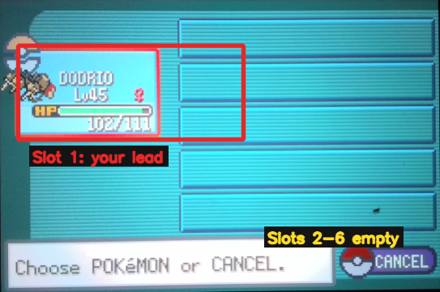
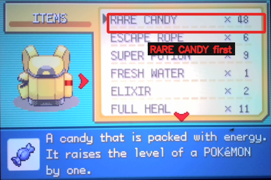
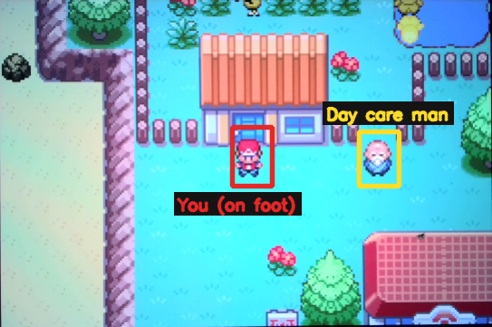
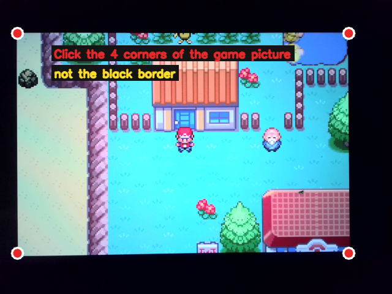
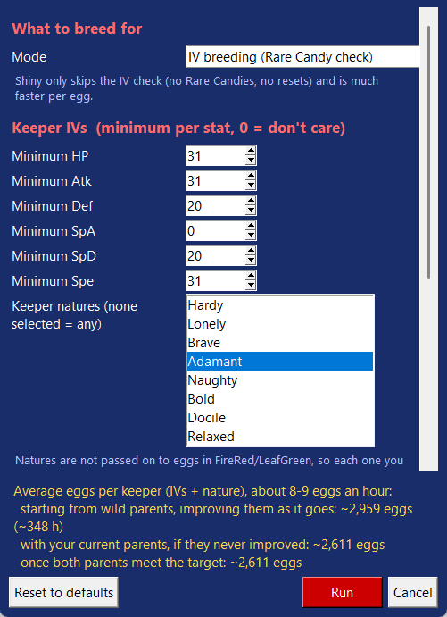
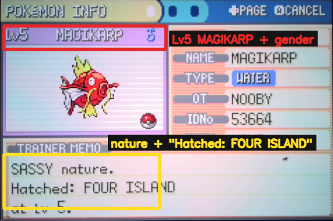

# FRLG Breeding (Magikarp)

Breeds Magikarp at the **Four Island day care** in Pokémon FireRed / LeafGreen (Nintendo Switch Online GBA app) and keeps only the eggs you want. Along the way it swaps better babies into the day care, so the parents keep getting better.

> Beta: this script is still being tested. Please report anything odd at noobysgamepro.com.

## What it does

The script works in batches of 5 eggs:

1. Collects eggs from the day care man and rides up and down until they hatch.
2. **IV mode:** saves the game, then uses Rare Candies to level each hatchling, working out its IVs and nature from the stats. It then resets the game, so the levels go away and **the candies come back**.
3. Keepers (and shinies) go to your keep box. A baby that would make a better parent is swapped into the day care.
4. The rest are released at the day care PC, then the game is saved and the next batch starts.

**Shiny only** mode skips the IV check. It hatches eggs and releases them, but always checks for the shiny star first and keeps any shiny.

## What you need

- A GamePRo for Switch with the **Home button servo (SR1)** working. IV mode restarts the game through the Home menu.
- A capture card or webcam showing the game, selected in GamePRo.
- In the day care: **a male and a female** from the Magikarp line (Magikarp or Gyarados). Any IVs will do to start. The script improves them over time.
- **Rare Candies** for IV mode. Any number works, but 20 or more is much quicker. They are never used up.

## Setting up the game

### Party

Slot 1 is your lead Pokémon (anything except an egg). **Slots 2-6 must be empty**, because the eggs go there.

### Bag

- Register the **BICYCLE to Y**.
- IV mode: **RARE CANDY must be the first item** in the ITEMS pocket.

### PC boxes

Make sure the **keep box** has free space (box 6 unless you change it). In IV mode, so must the **old-parent box** (box 5 unless you change it).

### Where to start

Set text speed to **FAST**, **SAVE** the game, then stand **on foot, outdoors**, near the day care man on Four Island.

## Starting the script

1. Connect the GamePRo and pick your camera.
2. Select **FRLG Breeding (Magikarp)** and press **Run Script**. The settings window opens (see below). Press **Run** when you're happy.
3. Click the **4 corners of the game picture**, inside the black border, while the game shows the outdoors with no menu open. If the corners don't line up, the script asks you to click them again.

## Settings

- **Mode:** **IV breeding** checks every baby's IVs and nature. **Shiny only** is faster per egg but only looks for shinies.
- **Minimum IVs:** the IV each stat must reach for a baby to be a keeper. 31 = perfect, 0 = don't care. Example for a physical Gyarados: HP 31, Atk 31, Spe 31, Def 20, SpD 20, SpA 0.
- **Keeper natures:** pick the natures you'd accept, e.g. **Adamant** and **Jolly**. Select none to accept any nature. FireRed/LeafGreen can't pass natures down, so every extra nature you allow makes keepers much more common.
- **Replaced parents:** when a better baby goes into the day care, the parent it replaces is either **released** (only ones this script bred, and never a keeper) or **put in the old-parent box**. The parents you put in yourself always go to the box.
- **Keep box / old-parent box:** which PC boxes to use.
- **When a shiny hatches:** stop with it in your party, or box it and carry on.
- **Stop after N batches:** each batch is 5 eggs.
- **New parents in the day care:** tick this if you changed the day care parents yourself since the last run.

The yellow text at the bottom is an **estimate**: on average, how many eggs it takes to get a keeper. It covers starting from wild parents, your current parents, and parents that already meet your target. The script runs about 8-9 eggs an hour, so strict targets can take days. Try allowing a second nature or lowering a minimum, and watch the estimate change.

## Safety: what gets released

The script never touches Pokémon already in your boxes. It only releases from the party view at the PC, and only when **every** check passes:

- The party on screen matches what the script expects. It stops if there is a Pokémon it doesn't know about.
- The summary shows a **Lv5 MAGIKARP** with **no shiny star**.
- The **gender and nature** match the ones it recorded when that baby first hatched.
- Keepers, shinies and parents have already left the party before any release starts.

If anything doesn't match, it backs out and stops rather than guess.

## Stopping and carrying on

Press **Stop** at any time. Progress is saved, and the next run carries on from where it stopped, including the parents' IVs it has learned.

> To carry on: close any menu, walk **outside on foot** near the day care man, then press Run Script again. **Don't save or reset the game yourself.** The script knows which state the game is in, and resets it by itself if it stopped during an IV check.

## Troubleshooting

- **"Those corners do not match the game picture":** close any menu, stand outdoors, and click exactly on the edges of the game picture, not the black border.
- **"The HOME button (SR1) did not open the Switch Home menu":** check the SR1 servo reaches the Home button (GamePRo calibration), then run again.
- **"No RARE CANDY found":** move Rare Candy to the top of the ITEMS pocket.
- **"The party has N Pokémon but the script expected M":** make slots 2-6 hold only what the script put there (or nothing), then run again.
- **It stopped during a release:** that's a safety check doing its job. Follow the "carry on" steps above. The log says which check failed.
