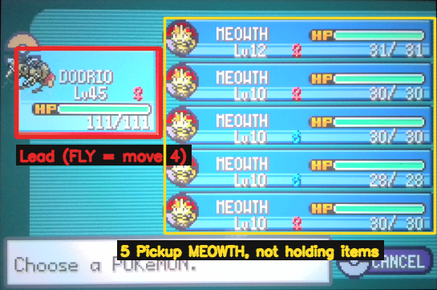
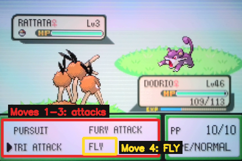
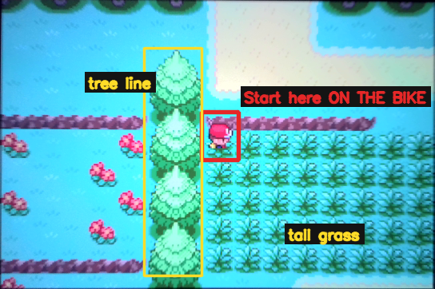
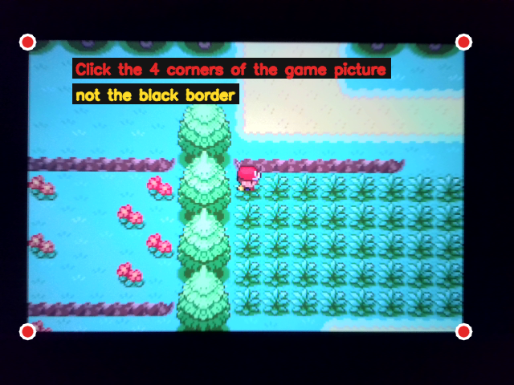

# FRLG Pickup Farm

Farms **Rare Candies**, Nuggets, PP Ups, TMs and berries with **Pickup Meowths** on Route 1, just south of Viridian City, in Pokémon FireRed / LeafGreen (Nintendo Switch Online GBA app).

> Beta: this script is still being tested. Please report anything odd at noobysgamepro.com.

## What it does

1. Rides the bicycle back and forth across a patch of tall grass. Each crossing is one long press, from the tree line to the trees on the other side.
2. Checks every wild Pokémon for a **shiny**, then knocks it out with your lead's moves 1-3.
3. Every 3 battles, opens the party and takes any items the Meowths picked up. Each item's name is read and counted in the log.
4. When the lead runs out of PP, it uses **FLY** to reach Viridian City, heals at the Pokémon Centre, rides back to the grass and carries on.

Pickup only works after a battle you **win**, so the lead knocks out everything. In testing it averaged about **2 battles a minute**, and a Rare Candy every 20-80 battles.

## What you need

- A GamePRo for Switch, with the D-pad / joystick servo working.
- A capture card or webcam showing the game, selected in GamePRo.
- A **lead Pokémon** strong enough to knock out Route 1 Pokémon in one hit.
- **5 Meowths with the Pickup ability.** Pickup is Meowth's only ability in FireRed/LeafGreen, so any Meowth works.
- The **BICYCLE**.

## Setting up the game

### Party

- **Slot 1:** your lead.
- **Slots 2-6:** the five Meowths, **not holding any items**.

### The lead's moves

**Moves 1-3** must be attacking moves. **Move 4 must be FLY**: it is never used in battle, only to fly back to Viridian City to heal.

> When the lead levels up and wants to learn a new move, the script always says NO, so its moves never change. Teach it new moves yourself if you want them, but keep FLY as move 4.

### Bag

- Register the **BICYCLE to Y**.
- Keep **free space in the ITEMS pocket**. Rare Candy, PP Up and Nugget each need a slot unless you already have some.
- The TMs and berries go to their own pockets.

### Where to start

Fly to Viridian City and go south onto Route 1. Jump down the first ledge and stand **on the bicycle** in the top row of the tall grass, right next to the tree line on your left.

> Start **on the bike**. The script doesn't try to work out whether you're riding (the tall grass hides the wheels), so if you start on foot it just walks, more slowly.

## Starting the script

1. Connect the GamePRo and pick your camera.
2. Select **FRLG Pickup Farm** and press **Run Script**.
3. Click the **4 corners of the game picture**, inside the black border.

The log shows each item as it is taken, and a summary every 10 battles, e.g.:

`== 40 battles in 20 min | Rare Candy: 4 | shinies: 0 | ...`

## Shinies

Shiny Pokémon play a sparkle animation before "Wild X appeared!". The script times every battle intro and treats one that is noticeably slower as a shiny. By default it **stops at the battle menu** so you can catch the shiny yourself.

## Items it doesn't recognise

Item names are read from the "Received the …" message. If the script can't read a name, for example because the camera's brightness changed, it logs **unknown item** and carries on. It also saves a picture of the message in the `pickup_items` folder (next to the script), called something like `unknown_20261106_201018.png`.

To teach it, rename that file to the item's name, e.g. `RARE CANDY_3.png`. Use capitals with a space, and add `_2`, `_3`… if a file with that name already exists. It will recognise that item next time.

## Advanced options

These are at the top of `FRLG_Pickup_Farm.py`, for anyone happy to edit the script:

- `SHINY_ACTION`: `'stop'` (default), `'catch'` (throws Ultra, then Great, then Poké Balls; the Master Ball is never used) or `'ko'`.
- `CHECK_EVERY`: battles between item checks (default 3).
- `MOVES`: which moves to use, if you don't want all of moves 1-3.

## Stopping and carrying on

Press **Stop** at any time. To carry on, put the player back in the starting spot on the bike and press Run Script again. If a menu was left open, the script closes it first.

## Troubleshooting

- **"No wild encounter after 80 crossings":** the player isn't in the grass. Go back to the starting spot.
- **"Nothing taken from Meowth N (BAG full, or no item after all)":** usually harmless. If it keeps happening, the ITEMS pocket is full. The script stops after 3 checks in a row like that. Make room and run again.
- **"Could not open the party screen" / "Could not talk to the nurse":** a button press didn't register. Check the GamePRo calibration (D-pad, A, X), then run again.
- **It isn't moving at all:** check that the D-pad / joystick servo still reaches the stick.
