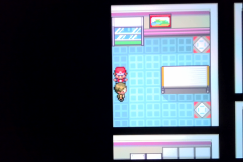
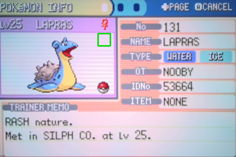

# FRLG Shiny Lapras

Soft-resets for a **shiny Lapras**, the gift from the Silph Co. employee, in Pokémon FireRed / LeafGreen (Nintendo Switch Online GBA app).

## What it does

1. Closes the game from the HOME menu and starts it again from your save.
2. Talks to the employee and accepts **Lapras**, without giving it a nickname.
3. Opens the party and Lapras's **summary**, and looks for the yellow **shiny star** just under its ♂/♀ sign.
4. If there's no star, it starts again. Each attempt takes about **70 seconds**.

When it finds a shiny, it logs **DETECTED!** and stops on Lapras's summary screen so you can see it.

> Shinies are 1 in 8192 in FireRed / LeafGreen. That's about **160 hours** of running on average, so expect it to run for days, not hours.

## What you need

- A GamePRo for Switch, running Switch firmware v1.5 or later.
- A capture card or webcam showing the game, selected in GamePRo.
- Pokémon FireRed or LeafGreen in the **Nintendo Switch Online – Game Boy Advance** app.
- A save in Silph Co., in front of the employee who gives Lapras. You can't get Lapras until you've beaten your rival there.

## Setting up the game

### Party

Have **exactly one Pokémon** in your party. Lapras must go into **slot 2**, because that's where the script looks for it. With 2–5 Pokémon it opens the wrong summary, and with a full party Lapras goes to the PC.

### Where to save

1. In Silph Co., stand **directly above the employee**, facing down towards him, without talking to him yet.
2. **Save the game** there (X → SAVE).

### The Switch

- The **GBA app must be the first tile on the HOME menu**, with FireRed / LeafGreen as the game it starts. The script restarts it with HOME → X (close) → A, then A to start it again.
- If the Switch has a **system update** waiting, install it first. Otherwise the "Update now?" prompt appears when the game starts, and the script's A presses would answer it.

## Starting the script

1. Connect the GamePRo and pick your camera.
2. **Recommended:** open a bright screen in the game, such as the party screen (X → POKéMON). The Silph Co. room is mostly black, which makes the screen hard to find automatically. The script restarts the game first, so it doesn't matter what's showing when you press Run.
3. Select **FRLG Shiny Lapras** and press **Run Script**.
4. **Screen corners:** the app finds the game picture by itself (version 1.12 and later) and draws a green outline. Click **✓ Use detected corners**.
   - If the outline is wrong, click the **4 corners of the game picture** yourself, inside the black border.
   - If the screen is too dark to find, the app offers **✓ Use last corners**. Use it if your camera hasn't moved.

The log shows `Attempt N complete.` after each try, and `Watching... 0 px match target` while it checks for the star.

## The shiny check

On the summary screen the script watches a small box where the shiny star appears. A normal Lapras shows **0 px**. A shiny's star gives about 40–50 px, and the threshold is 10.

## When it finds a shiny

1. The log says **DETECTED!** and the script waits on Lapras's summary screen.
2. Check that Lapras is shiny: it's **purple**, with a yellow star.
3. Press **Stop**.
4. **Save the game**: B to leave the summary and the party, then X → SAVE. You can use the Manual Controls, or a controller.

> Don't press Run again before saving. The script's first step closes the game, which would lose the shiny.
